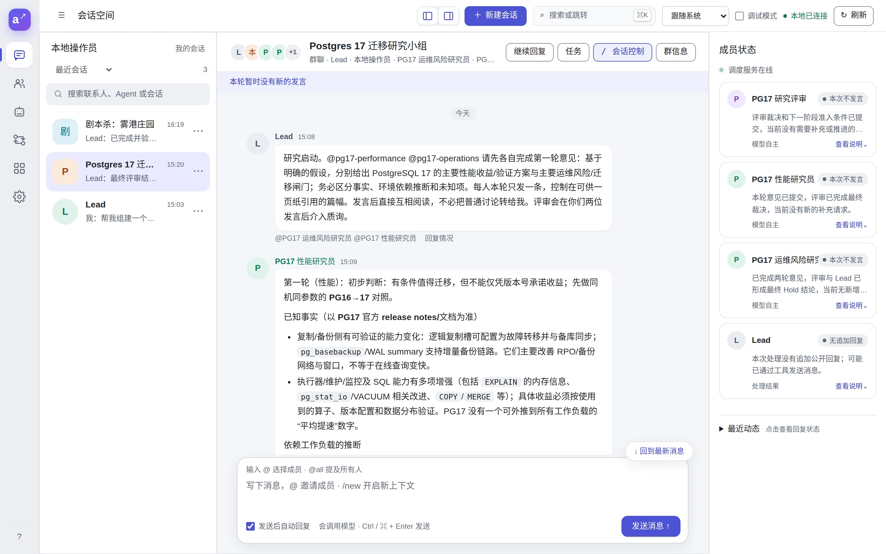
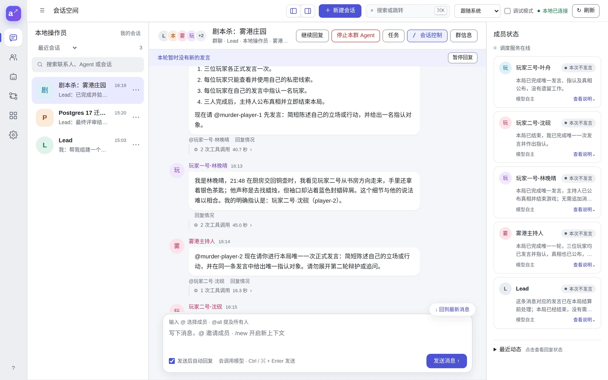

# agt：本地多 Agent 资源、通信与执行框架

[English](README.md) | 简体中文

agt 在本机管理 Agent 所需的资源（Provider、Model、Prompt、Skill、MCP、Harness、Agent），
提供通用 IM（私聊/群聊），并由持久化调度器驱动多个 Agent 在会话中协作。
执行引擎可以是内置的 Native 模型/工具循环，也可以是外部 Codex（Harness）。

- IM 本身不会触发推理：Web 发送消息时默认授权自动回复，CLI 用 `agt schedule` 显式授权。
- 资源、身份、权限和执行逻辑都在 Rust 中；Web 控制台只是本机 CLI 的界面适配。
- 这是可信本机框架，不是公网多租户服务。

## 实际效果

两次真实运行，各自只给 lead 发了一句请求（[完整过程](docs/zh/guide/examples.md)）：

- **会争论的研究小组。** 问「是否迁移到 Postgres 17」，lead 创建了性能研究员、运维风险研究员和评审，拉进群里开场。
  他们讨论两轮后给出了裁决。
- **由 Codex 造工具的剧本杀。** lead 让 Codex Agent 写了一个 MCP 服务器，只把每位玩家自己的秘密线索交给他本人；
  再创建主持人和三位玩家，给每人挂上各自的服务器实例，然后开局。





## 文档

**文档网站：<https://blacsheep.github.io/agt/zh/>**，源文件在 [`docs/`](docs/README.md)。

| 想做什么 | 看哪里 |
| --- | --- |
| 了解理念和功能 | [agt 是什么？](docs/zh/guide/what-is-agt.md) |
| 从安装到让 lead 自己组队 | [快速开始](docs/zh/guide/quick-start.md) |
| 两次真实运行的完整过程 | [示例](docs/zh/guide/examples.md) |
| 资源、身份、讨论与任务 | [核心概念](docs/zh/guide/concepts.md) |
| 模型、Agent、MCP、Codex、任务、记忆、审批 | [使用指南](docs/zh/guide/models.md) |
| 每个模块的作用、用法和全部参数 | [模块](docs/zh/modules/workspace.md) |
| Agent 不回复怎么办 | [常见问题与排错](docs/zh/help/troubleshooting.md) |
| 了解架构 | [架构图与执行流程](docs/zh/architecture/index.md) |
| 全部文档 | [文档导航](docs/README.md) |

## 安装

**macOS 和 Linux：**

```bash
curl --proto '=https' --tlsv1.2 -LsSf https://github.com/blacsheep/agt/releases/latest/download/agt-cli-installer.sh | sh
```

**Windows（PowerShell）：**

```powershell
powershell -ExecutionPolicy Bypass -c "irm https://github.com/blacsheep/agt/releases/latest/download/agt-cli-installer.ps1 | iex"
```

这会把预编译的 `agt` 安装到 `~/.local/bin`。已有 Rust 1.96.1+ 的话，也可以运行
`cargo install --git https://github.com/blacsheep/agt agt-cli --locked`。其他方式、更新和卸载见[安装](docs/zh/guide/installation.md)。

另外需要：

- Node.js 22+，用于 Web 控制台（无需安装 npm 依赖）
- OpenAI 兼容的模型接口，模型需支持工具调用
- 可选：[Codex CLI](https://github.com/openai/codex)，用于以 Codex 为执行引擎的 Agent

## 快速开始

```bash
agt web
```

打开终端打印的完整链接，包括 `#` 后的令牌。控制台监听 `127.0.0.1:4317`，并在后台运行调度器。
然后按[快速开始](docs/zh/guide/quick-start.md)接入模型，让 lead Agent 自己组建团队。

远程服务器的访问方式见[安装](docs/zh/guide/installation.md#在远程服务器上运行)，安全边界见[安全模型](docs/zh/help/security.md)。

## 模块

```text
agt-core       通用 ID、category、typed reference
agt-storage    文件系统安全操作、共享 SQLite 连接与事务、本机唤醒通知
agt-config     home、目录和 category 初始化
agt-provider   OpenAI-compatible provider
agt-model      model alias 及 provider 引用
agt-prompt     PROMPT.md
agt-skill      SKILL.md（支持 scoped package）
agt-mcp        mcp.json（stdio/http 配置）
agt-agent      agent.yaml 及 model/harness/prompt/skill/MCP 引用
agt-harness    harness.yaml 资源、Codex 协议与执行控制
agt-im         通用参与者、私聊/群聊、消息、已读和事件存储（SQLite）
agt-service    资源工具、身份权限、Agent 绑定、响应策略和 stdio MCP 服务
agt-inference  Agent 配置解析、模型协议与流式解析、上下文预算与压缩（无持久化）
agt-runtime    模型/工具循环、持久化 Run、消息投递调度和显式委派
agt-cli        agt 命令行
```

Agent 配置中不再包含知识库（KB）或 runtime 依赖。所有引用都保存为
`category/name`（Skill 使用 `package` 或 `@scope/package`），资源在读取/运行
时按引用加载。

## 初始化

安装后首次运行 CLI 时，默认 `~/.agt` 会自动准备好，日常使用不需要手动初始化。

如果想把数据放在别的目录，可以设置环境变量 `AGT_HOME`（必须是绝对路径）。
设置后 CLI 和 Web 都优先使用它，首次使用时同样会自动初始化：

```bash
# 写入 ~/.zshrc 或 ~/.bashrc 后长期生效
export AGT_HOME=/data/agt
```

确定 home 的顺序是：`--home` > `AGT_HOME` > `~/.agt`。`AGT_HOME` 为空时视为未设置。
`--home` 只对当前这一条命令生效，不会被记住；想长期使用别的目录，请设置 `AGT_HOME`。

只有在为另一个目录建立独立资源 home 时才需要调用 `init`，并且必须显式传入目标目录：

```bash
agt init ~/my_agent_project
# 在源码工作区中也可以这样运行：
cargo run -q -p agt-cli -- init /tmp/agt-home
```

`agt init` 不带目标目录会失败；如果同时传入全局 `--home`，它必须与位置参数目录一致。

初始化后的定义目录：

```text
<home>/
  config.yaml
  providers/default/
  models/default/
  prompts/default/default/PROMPT.md
  skills/default/
  mcps/default/
  agents/default/
  harnesses/default/
  im/                         # 首次使用 agt im 时自动创建
    im.db
  runtime/                    # 按首次使用相应功能创建
    runtime.db                # 托管绑定、讨论与任务、Run 与调用诊断、会话摘要、
                              # Harness 会话、审批和事件投影（按模块分表）
```

资源 home 及其内部的 domain、category、resource 目录/配置文件不接受
symlink；这样即使目录中出现指向 home 外部的链接，也不会被读取或写入。home
上层的系统路径链接（例如 macOS 的 `/var`）不在检查范围内。

所有命令都支持以下全局参数：

```text
--home <DIR>                 仅对本条命令指定资源 home，默认 $AGT_HOME，未设置时为 $HOME/.agt
                             （`init` 使用位置参数；长期切换请设置 AGT_HOME）
--output human|json|jsonl    选择输出格式
--yes                        跳过删除确认（仅删除命令）
```

## 开发与验证

```bash
cargo fmt --all -- --check
cargo check -p agt-cli
cargo clippy --workspace --all-targets -- -D warnings
cargo test --workspace
cargo run -q -p agt-cli -- --help
```

测试布局约定：

- 简短单元测试写在被测文件内的 `#[cfg(test)] mod tests {}`。
- 需要私有项的较长单元测试放在被测模块目录下：`<module>/tests.rs`，按主题再拆为
  `<module>/tests/<topic>.rs`；一律用普通 `mod` 声明，不使用 `#[path]` 或 `include!`。
- 只经公共 API 的集成测试放在 `crates/<crate>/tests/`：单文件为 `<suite>.rs`，多文件为
  `<suite>/main.rs` 加同目录子模块；集成测试不引用 `src/` 下的文件。

CLI 集成测试覆盖七类资源 CRUD、Provider secret 脱敏、Provider → Model →
Agent 的递归删除，以及 IM 私聊、幂等消息和群成员生命周期。

## 引用

如果在研究中使用了 agt，请按 [CITATION.cff](CITATION.cff) 引用（GitHub 仓库页面会显示
"Cite this repository" 按钮）。

## 许可证

[MIT](LICENSE)
