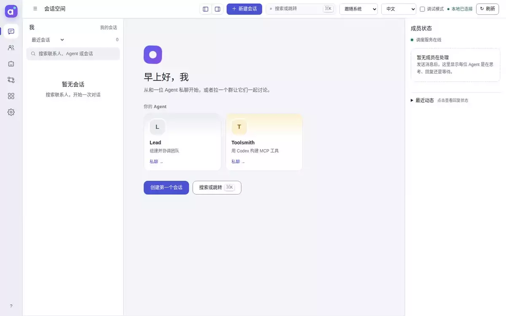
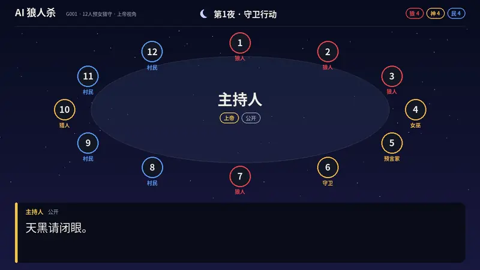
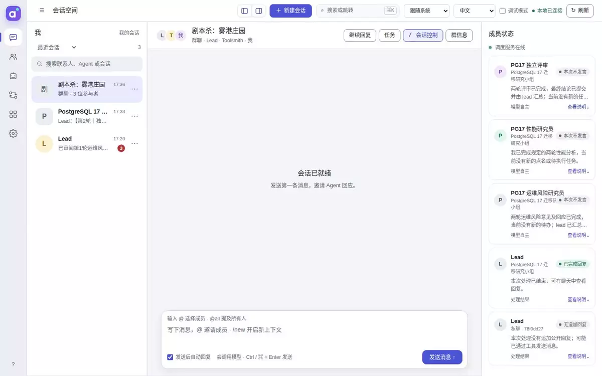

<p align="center">
  
</p>

<h1 align="center">agt</h1>

<p align="center">
  <b>让 Agent 自己组建团队。</b><br>
  <a href="README.md">English</a> · 简体中文 · <a href="https://blacsheep.github.io/agt/zh/">文档</a>
</p>

<p align="center">
  <a href="https://github.com/blacsheep/agt/actions/workflows/ci.yml"></a>
  <a href="https://github.com/blacsheep/agt/releases/latest"></a>
  <a href="LICENSE"></a>
  
  <a href="https://blacsheep.github.io/agt/zh/"></a>
</p>

agt 是一个在你自己机器上运行的多 Agent（多智能体）编排框架。你只需要和其中一个 Agent 对话：lead。告诉它要做什么，它会写好角色 Prompt、创建 Agent、让编程 Agent 把缺的工具做出来，再把大家拉进群里推进工作。你可以旁观，随时插话，需要审批的操作由你决定。



## 和其他框架有什么不同

大多数多 Agent 框架要求你在运行之前就写好有哪些 Agent、各自用什么工具、彼此怎么连接。在 agt 里，组建团队这件事由 Agent 自己完成。

**Agent 用工具管理资源。** Prompt、模型、MCP 服务器和 Agent 定义都是 agt 管理的文件，拥有 `resource_management` 能力的 Agent 可以通过工具调用创建和修改它们。lead 就是这样从一句话搭出一个能干活的团队；它创建的每样东西都是你能打开、能修改的文件。

**团队在聊天里协作。** Agent 之间有私聊和群聊，会互相 @，和人一样。调度器决定谁回复、谁等待、谁保持安静。不需要事先设计流程图：编排就发生在对话里，按工作需要自然展开。

**隔离由工具保证。** Agent 能做的事只取决于挂在它身上的工具，新建的 Agent 也不会继承创建者的工具。下面的剧本杀里，每位玩家的工具只能返回他自己的线索，用不着在 Prompt 里叮嘱谁别偷看。

**Codex 也是团队成员。** Agent 可以跑在 [Codex](https://github.com/openai/codex) 会话上，而不是内置的模型循环。lead 把需求交给它，拿回一个测试过的 MCP 服务器，再挂给需要的 Agent。

**重启不丢工作。** 会话、执行、任务和审批都保存在 SQLite 里。未完成的工作会从中断处继续；结果不确定的工作会标记出来交给你处理，而不是再执行一遍。

**控制权在你手里。** 每次工具调用都可以等你批准、先交给审核模型，或者直接放行。Web 控制台会显示谁在做什么，包括你不在其中的 Agent 之间的对话。

## 实际效果

一个完整项目和两次真实运行，各自只给 lead 发了一条消息。[示例页](docs/zh/guide/examples.md)有完整过程。

**[AI 狼人杀](https://github.com/blacsheep/werewolf-game)，基于 agt 的完整项目。** 12 个 AI 玩家和 1 个 AI 上帝打一局 12 人预女猎守。每名玩家挂一个只属于自己的引擎 MCP，从而实现角色隔离。给 lead 发一句话就能跑完一整局，之后由配音和回放 Agent 生成整局语音、网页回放和视频。



**由 Codex 造工具的剧本杀。** lead 让 Codex Agent 写了一个线索服务器，再创建主持人和三位玩家，给每位玩家一个锁定在他本人身份上的服务器实例，然后开局。



**会争论的研究小组。** 问「是否迁移到 Postgres 17」，lead 创建了性能研究员、运维风险研究员和评审，建群开场。评审对两位研究员逐一质询，两轮之后小组给出了裁决。本页顶部的录屏就是这次运行。

## 安装

agt 有命令行和桌面应用两种形式，两者使用同一份数据，可以随时切换。

### 命令行

macOS 和 Linux：

```bash
curl --proto '=https' --tlsv1.2 -LsSf https://github.com/blacsheep/agt/releases/latest/download/agt-cli-installer.sh | sh
```

Windows（PowerShell）：

```powershell
powershell -ExecutionPolicy Bypass -c "irm https://github.com/blacsheep/agt/releases/latest/download/agt-cli-installer.ps1 | iex"
```

安装脚本会把预编译的 `agt` 放到 `~/.local/bin`，Web 控制台已经内置在其中。其他安装方式、更新和卸载见 [安装](docs/zh/guide/installation.md)。

### 桌面应用

AGT Studio 是控制台的桌面版，支持 macOS、Windows 和 Linux，带托盘图标和系统通知。从[最新发布](https://github.com/blacsheep/agt/releases/latest)下载对应系统的安装包（`.dmg`、`-setup.exe`、`.AppImage` 或 `.deb`）。见[桌面客户端](docs/zh/guide/desktop.md)。

两种方式都需要一个支持工具调用的模型接口：OpenAI 或兼容服务、Anthropic、Google Gemini 都可以。编程类 Agent 还需要它所运行的工具，例如 [Codex CLI](https://github.com/openai/codex) 或 [Claude Code](https://claude.com/claude-code)。

## 快速开始

```bash
agt web
```

打开它打印的链接（包括 `#` 后面的令牌），或者打开 AGT Studio。接入模型、创建 lead、给它一个目标，[快速开始](docs/zh/guide/quick-start.md)会带你走完每一步。控制台只监听 `127.0.0.1`；在服务器上使用时，请通过 [SSH 隧道](docs/zh/guide/installation.md#在远程服务器上运行)访问。

## 文档

[文档网站](https://blacsheep.github.io/agt/zh/)提供中英文两个版本。

| 想要 | 阅读 |
| --- | --- |
| 了解基本想法 | [agt 是什么？](docs/zh/guide/what-is-agt.md) |
| 让 lead 组建第一个团队 | [快速开始](docs/zh/guide/quick-start.md) |
| 看两次完整运行 | [示例](docs/zh/guide/examples.md) |
| 理解各个组成部分 | [核心概念](docs/zh/guide/concepts.md) |
| 配置模型、Agent、MCP、Codex、任务、记忆或审批 | [使用指南](docs/zh/guide/models.md) |
| 查某个命令或配置项 | [模块](docs/zh/modules/workspace.md) |
| Agent 不回复怎么办 | [常见问题与排错](docs/zh/help/troubleshooting.md) |
| 了解哪些地方不能对外暴露 | [安全模型](docs/zh/help/security.md) |

## 数据存放在哪里

所有数据都放在一个目录里，默认是 `~/.agt`，第一次运行 `agt` 时自动创建。设置 `AGT_HOME` 可以换到别的目录；运行 `agt init <目录>` 可以为某个项目单独建一个 home：

```text
~/.agt/
  config.yaml                       工作空间设置
  providers/ models/ prompts/ skills/ mcps/ agents/ harnesses/
  im/im.db                          会话和消息
  runtime/runtime.db                执行、任务、审批、Codex 会话
```

agt 面向在可信机器上使用的单个用户，不是托管服务，也不支持多用户。

## 参与开发

构建与测试方法、crate 结构和发布流程见 [CONTRIBUTING.md](CONTRIBUTING.md)。内部设计见[架构文档](docs/zh/architecture/index.md)。

## 引用与许可证

如果在研究中使用了 agt，请按 [CITATION.cff](CITATION.cff) 引用。agt 以 [MIT 许可证](LICENSE)发布。
