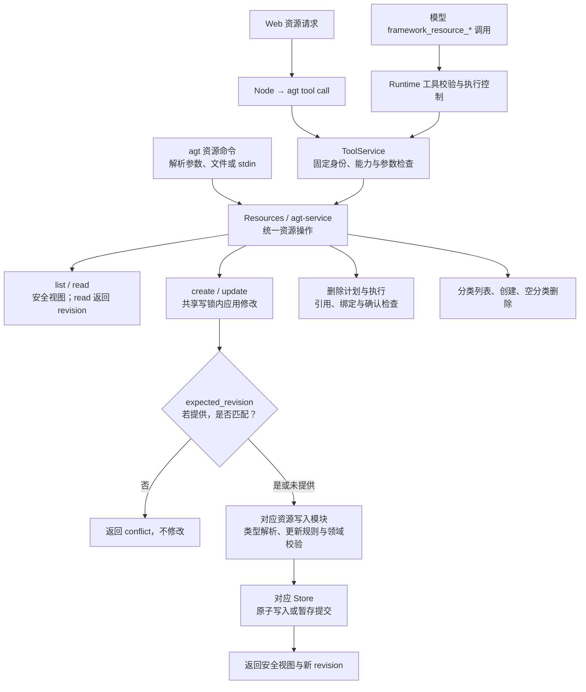
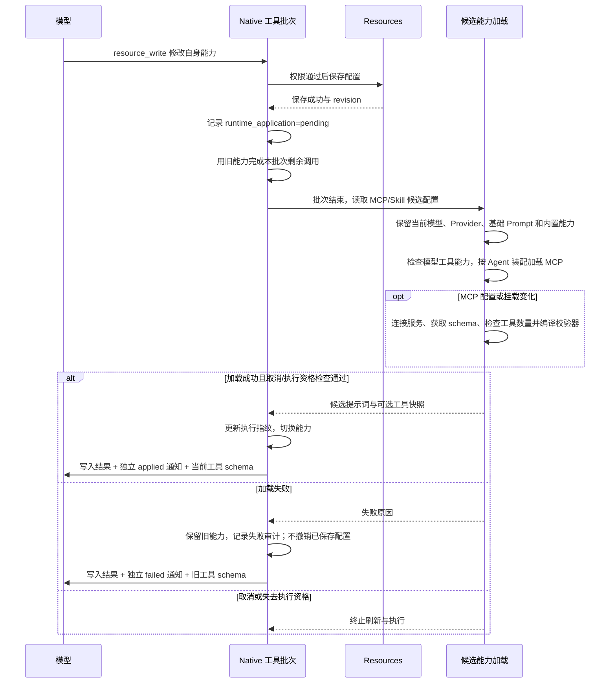

# 资源管理与能力生效

最近代码核对：2026-10-09。此页描述已实现行为，覆盖 Agent、Model、Provider、
Prompt、Skill、MCP、Harness 七类配置资源。身份绑定、消息、Run 和 WorkItem
继续由各自业务模块管理。

## 共享资源管理入口

CLI 和 ToolService 调用同一个资源服务，不在入口层分别修改配置。
七类资源按模块分开，保留 Skill 文档/文件包、MCP 连接配置、Provider 凭据等差异。
CLI 可投影结果以保持既有 info/read 输出形状。

- `data` 保留原有更新语义；Agent 集合字段出现时整体替换，省略则保持。
- `add/remove` 支持 Agent 的 skills、mcps、builtin_tools；新增去重，移除不存在项失败。
  同字段的替换/清空不能与集合增删混用，同一规范化引用不能同时增删。
- `clear` 只支持明确允许清空的字段，不提供任意 JSON 路径修改。
- `revision` 是持久化内容指纹，不是递增计数；`expected_revision` 可选。
  Web Agent/Harness 编辑携带读取时的版本，旧客户端不传版本时保留既有覆盖语义。
- `.resources.lock` 覆盖管理读写、分类修改和删除执行；联网查询与探测先在锁内读取配置，
  再在锁外使用该快照执行。外部手工文件编辑不参与这把锁。
- 删除复用依赖图、显式计划确认及绑定检查。文件与 IM/绑定数据库不构成全局事务。
- 保存配置不自动连接 MCP、安装依赖或启用 Agent。MCP 探测是独立操作。

完整字段契约见[共享资源管理](resources.md)。

## Native 自身能力刷新

触发条件是当前 Native Run 成功调用 `framework_resource_write`，修改自身 MCP/Skill
挂载，或者修改当前已挂载的 MCP/Skill 资源。多个符合条件的写入合并到批次结束时刷新一次。

Skill 单独变化不会重启现有 MCP 连接。MCP 变化时，候选连接、工具 schema、校验器和
执行路由准备完成后才切换；工具别名由资源引用及远端工具名决定，挂载重排不会串到另一服务。
模型可以从刷新后的下一次请求开始使用新工具，批次内不会改变能力。

刷新结果写入调用审计，并作为独立通知加入模型上下文。加载失败不会自动反复重试。
成功刷新的执行指纹进入挂起检查点；恢复仍会重新装配并核对指纹与工作目录，不重放已完成工具。

## 生效范围

| 修改来源或内容 | 当前行为 |
| --- | --- |
| Native Run 成功修改自身 MCP/Skill | 本工具批次完成后刷新，加载成功才对当前 Run 生效 |
| Native Run 修改另一个 Agent | 该 Agent 的后续新 Run 加载，不刷新它当前执行 |
| Web/CLI 修改配置 | 后续新 Run 加载，不向当前 Run 注入刷新 |
| Model、Provider、基础 Prompt、内置能力、委派配置 | 不随 MCP/Skill 刷新改变当前 Run |
| Harness 执行 | 不使用 Native 能力刷新；AGT MCP 挂载仍不支持，已有会话保留其配置语义 |

管理员实时切换审批策略的既有行为独立保留。能力刷新不会扩大 Framework 能力。
MCP 使用范围由 Agent 装配决定，未装配的工具不可调用；具体调用仍经过权限审批，
没有绑定或 Discussion 的 MCP 总开关。资源的 `revision` 与 Run 的 `config_fingerprint`
也不是同一个标识：前者检测资源编辑冲突，后者检查执行及恢复配置。

## 代码与验证入口

- [资源服务](../../crates/agt-service/src/resources/mod.rs)与[更新/版本检查](../../crates/agt-service/src/resources/mutation.rs)。
- [CLI 适配](../../crates/agt-cli/src/main.rs)与[工具协议](../../crates/agt-service/src/tools.rs)。
- [删除依赖与执行](../../crates/agt-service/src/deletion.rs)。
- [批次执行](../../crates/agt-runtime/src/engine/native/tools.rs)与[能力刷新](../../crates/agt-runtime/src/engine/native/refresh.rs)。
- [配置解析](../../crates/agt-inference/src/resolve.rs)与[MCP 快照](../../crates/agt-runtime/src/engine/native/mcp.rs)。
- [资源回归](../../crates/agt-service/tests/service/assembly.rs)：七类版本冲突、集合并发与失败原子性。
- [运行时回归](../../crates/agt-runtime/tests/runtime/tool_contract.rs)：自装配、失败保留、授权与工具别名。
- [挂起恢复回归](../../crates/agt-runtime/src/scheduler/tests/wait_tests.rs)：刷新后恢复且不重放配置写入。

回归使用本地模型和 MCP 夹具，不调用真实模型。
返回[架构图导航](README.md)。
