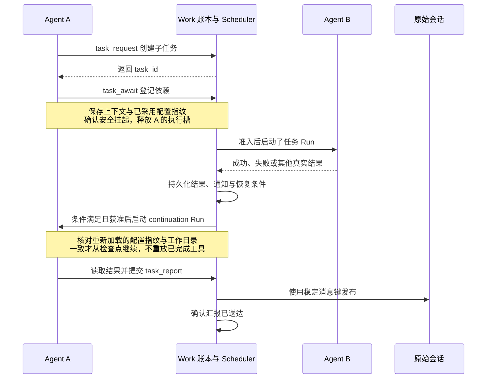

# 异步任务协作

最近代码核对：2026-10-09。此图描述 `task_*` 持久任务协作，不是显式 Run 内的同步 `delegate`。

## 关键约束

- WorkItem 保存明确请求，ScheduledTask 承担执行调度；一个 WorkItem 可以关联多次 Run。
- `task_request` 返回任务 ID 只表示已入队，不表示执行已经开始。
- `task_await`、`task_yield`、`task_input` 只在支持恢复的托管工作上下文中开放。
- Native 保存自身上下文检查点；Codex 等协议确认 turn 安全结束后保存会话检查点，再进入等待。
- 等待不占执行槽。依赖就绪、定时到期或有效业务答复可以触发继续执行，恢复仍需通过授权与准入。
- Native 自身 MCP/Skill 刷新成功后，检查点使用更新后的指纹；后续配置或工具 schema
  发生不兼容变化仍会拒绝恢复。刷新失败保留旧指纹，不把未加载配置视为已采用。
- 检查点缺失、配置不兼容或旧执行未安全退出时，不从原始输入重启来伪装恢复。
- 子任务失败不自动等于父任务失败；恢复后由父任务处理实际结果。结果不确定不能冒充成功。
- 任务终态、通知处理和原会话汇报是不同状态。读取结果不等于完成汇报。
- 结果发布使用稳定消息键；IM 已写入但确认丢失时，只补齐发布确认，不重跑模型。
- 暂停、结束、上下文重置、成员变化与身份停用仍约束执行及发布。外部副作用不确定时需核对。
- 默认同身份串行；显式并行需全局开关和任务策略共同允许，并检查声明的共享资源键。

## 代码入口

- [任务账本](../../crates/agt-runtime/src/work.rs)：`WorkLedger`、`WorkRequest`。
- [任务工具](../../crates/agt-runtime/src/work/control.rs)：固定 Actor 的 `TaskControl`。
- [任务分派与对账](../../crates/agt-runtime/src/work/dispatch.rs)：Run 关联、通知和 publication。
- [等待与恢复](../../crates/agt-runtime/src/work/wait.rs)：`Checkpoint`、等待登记与恢复。
- [汇报责任](../../crates/agt-runtime/src/work/reporting.rs)。
- [并行与资源互斥](../../crates/agt-runtime/src/work/execution_policy.rs)。

详细行为见[异步任务使用指南](../guide/tasks.md)；返回[架构图导航](README.md)。
