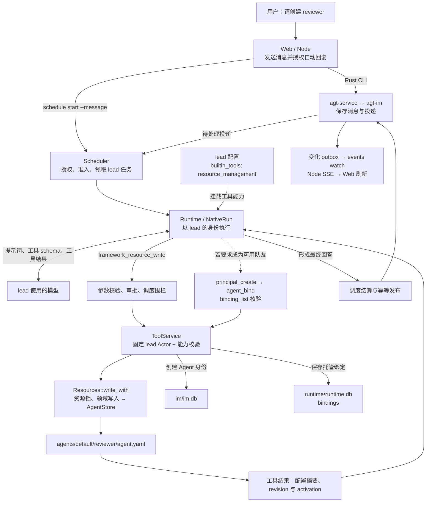
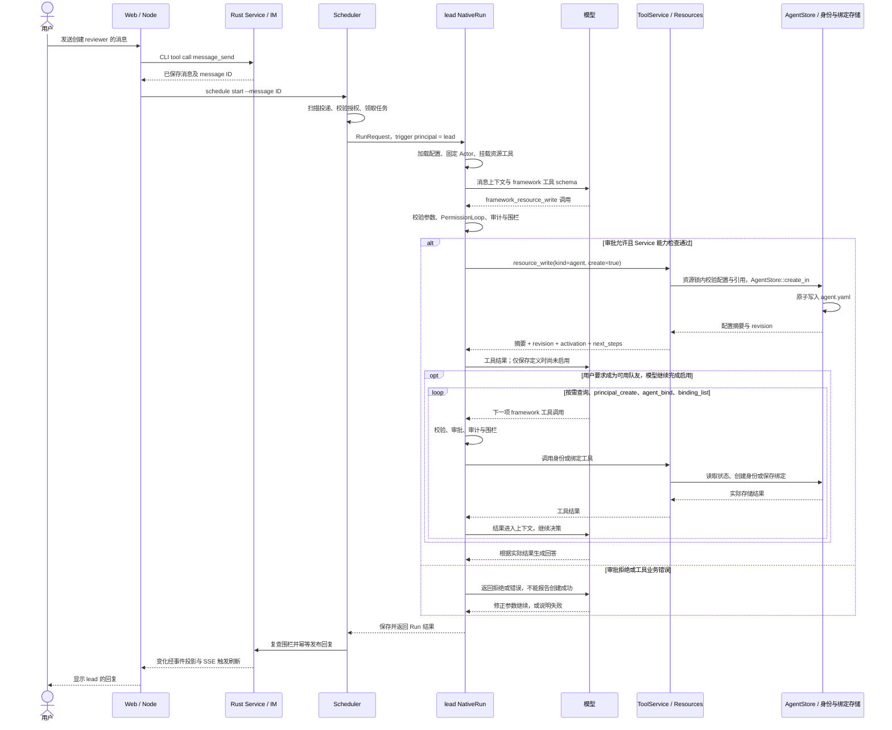

# 场景：Web 请求 lead 创建 Agent

最近代码核对：2026-10-09。以下以 Native lead 为主线，末尾说明 Harness 差异。
这是当前实现的静态调用链；工具示例不代表已经在用户 home 中执行。

用户在 Web 私聊 lead：“创建一个 reviewer Agent，使用已有的 default/fast 模型。”
此例假设 lead 已绑定到启用的 Agent 身份，配置挂载 `resource_management`，
Web 发送时开启自动回复，目标 Model 已存在，且通过当前调度与工具审批策略。
群聊中还需满足成员、响应策略和参与判断条件。

**创建 Agent 定义与启用可运行身份是不同操作。** 如果用户要求创建可用队友，
lead 还需创建或确认 Agent principal，再建立 binding 并核验启用状态；只要求保存定义时无需做这些步骤。
工具调用由模型选择，不是 Web 收到这句话后执行的固定脚本。

## 在整体架构中的位置

这是[整体架构](overview.md)中“聊天入口 → Runtime → Service → 资源存储”的具体路径。
资源工具由当前 Rust 执行进程直接调用，不经 Node 回调，也无需另起 `agt serve`。



`resource_management` 来自 lead 的配置快照。模型看到的是可用工具 schema，
实际权限仍由执行器和 Service 检查。Actor 是 lead 的绑定身份，不是发消息的 Web 用户，
也不会因该消息而获得用户的 Manager 身份。

当前代码的资源管理能力包括 Agent 生命周期操作：资源管理 Agent 可以创建 `kind=agent`
身份、绑定和启停 Agent。不能依据旧说明把它理解为只有配置 CRUD，或可以创建任意类型的身份。

## 完整调用时序

图中省略了可选的资源查询，以及每个工具都重复经过的 schema、审批、审计和调度检查。
工具可能在同一模型响应中形成批次，也可能分多个回合调用；这里按逻辑依赖顺序展示。



若 lead 已通过消息工具向当前会话发送回答，现有去重机制会抑制重复发布最终文本。
致命错误、取消或发布失败走通用 Run / 调度终态处理，不保证总有一条成功回复。

## 实际工具与文件落点

模型侧名称带 `framework_` 前缀，Service 内部名称不带。实际创建入口是
`resource_write`，不存在独立的 `resource_create` 工具。

1. 查询已有资源和身份，避免引用缺失或误用其他 Agent 的身份：
   `framework_resource_list` / `framework_resource_read`、`framework_principal_list`、`framework_binding_list`。
2. 调用 `framework_resource_write`：

```json
{
  "kind": "agent",
  "reference": "default/reviewer",
  "create": true,
  "data": {
    "model": "default/fast",
    "description": "负责代码审查的 Agent"
  }
}
```

该操作经共享资源服务，在资源锁内校验配置和引用，写入 `<home>/agents/default/reviewer/agent.yaml`。
已有同名定义会使创建失败，不会静默覆盖。首次创建且没有绑定时，返回的 `activation`
包含 `configured=false`、`enabled=false` 和启用步骤提示。

3. 如要求成为可用队友，且没有适用身份，调用 `framework_principal_create`：

```json
{"id":"reviewer","name":"Reviewer","kind":"agent"}
```

4. 调用 `framework_agent_bind`，显式关联身份与定义：

```json
{"principal":"reviewer","agent":"default/reviewer","policy":"mentioned"}
```

5. 调用 `framework_binding_list`（参数 `{}`）确认目标绑定 `enabled=true`。
   新绑定默认启用；更新已有停用绑定不会自动恢复，必要时还需
   `framework_agent_set_enabled`，参数为 `{"principal":"reviewer","enabled":true}`。

| 完成到哪一步 | 实际结果 | 尚未意味着什么 |
| --- | --- | --- |
| resource_write | Agent 定义已保存 | 没有自动创建身份、绑定或发起执行 |
| principal_create | IM 中已有 Agent 身份 | 还没有指定由哪份 Agent 配置执行 |
| agent_bind 并核验启用 | 身份可以按策略处理获授权的消息 | 没有自动加入 lead 所在群、完成模型连通性验收或开始某项工作 |

如果还要把 reviewer 加入会话或分配工作，那是后续独立操作。
异步分配工作还需要 lead 挂载 `task_collaboration`，见[异步任务协作](task-flow.md)。
新 Agent 不自动继承 lead 的资源管理或本机执行能力；能力须在新定义中明确配置。

## 已有 Agent 的配置更新与能力生效

修改已有 reviewer 使用 `resource_write(create=false)`。集合增删通过 `add/remove`，
整体替换继续使用 `data.skills/mcps/builtin_tools`；需要防止覆盖过期编辑时，
先读取资源，将返回的 `revision` 作为 `expected_revision` 提交。

lead 修改 reviewer 不会自动刷新 reviewer 当前正在执行的 Run，后续新 Run 加载配置。
如果 Native lead 修改的是**自己的** MCP/Skill，当前工具批次结束后会尝试加载，
并单独报告 applied 或 failed；保存成功不能代替加载成功或身份启用。
完整流程见[资源管理与能力生效](resource-flow.md)。

## 权限、失败与引擎差异

- **能力与审批分开：** 挂载 `resource_management` 使资源及 Agent 生命周期工具可用；
  Native 每次调用还经过 `PermissionLoop`，其行为取决于人工、自动允许或模型审核策略。
  Service 最后仍校验能力，审批允许不能绕过该校验。
- **步骤不是一个全局事务：** 配置文件、IM 身份、binding 分别保存。
  中间失败可能留下“定义已存在，但还未启用”的状态；应查询现状后补齐，而非盲目重复创建。
- **配置与连通性分开：** 创建时会校验 Model、Prompt 等引用；不会因此运行新 Agent 的模型来证明其可用。
- **启用具有实际影响：** `agent_bind` 可能让已有获授权投递开始被处理；启用不是纯显示标记。
- **Harness lead：** 前后端消息路径和最终 Service 存储路径相同，但中间由 Codex app-server
  经 dynamicTools 调用 `framework_resource_write`。AGT 工具桥接仍检查身份、能力与调度围栏，
  不经过 Native `PermissionLoop`；Codex 自己的审批请求走 Harness approval bridge。
- **创建外部 Agent：** 可将示例中的 `model` 替换成已存在的 `harness` 引用，两者互斥。
  这不会安装 Codex、创建容器或立即运行外部引擎。

## 代码依据与维护入口

- [Web 服务](../../web/server.mjs)：`message_send` 后的 `schedule start --message`。
- [调度执行](../../crates/agt-runtime/src/scheduler/execution.rs)：构造 `MessageTrigger`，使用 binding principal。
- [Native 准备](../../crates/agt-runtime/src/engine/native/prepare.rs)：`with_resource_management` 与 `framework_` 工具 schema。
- [Native 工具阶段](../../crates/agt-runtime/src/engine/native/tools.rs)：`PermissionLoop::authorize` 与执行审计。
- [Service 工具](../../crates/agt-service/src/tools.rs)：`resource_write`、`activation`、`principal_create`、`agent_bind` 及 schema。
- [资源入口](../../crates/agt-service/src/resources/mod.rs)：`Resources::write_with`；[Agent 写入](../../crates/agt-service/src/resources/agent.rs)。
- [Agent 存储](../../crates/agt-agent/src/store.rs)：`AgentStore::create_in`、引用校验与原子写入。
- [身份绑定](../../crates/agt-service/src/bindings.rs)：`BindingStore::bind`、`set_enabled`。
- [Harness 工具桥](../../crates/agt-runtime/src/harness/tools.rs)：`ToolBridge`。
- [已有集成测试](../../crates/agt-runtime/tests/runtime.rs)：`resource_agent_can_create_enable_disable_and_resume_a_teammate`，覆盖创建后未启用、绑定后启用、停用与恢复；本次文档更新未重新执行该测试。

更新资源工具名称、能力范围、activation 返回值或绑定行为时，应同步更新本场景。
返回[架构图导航](README.md)。
