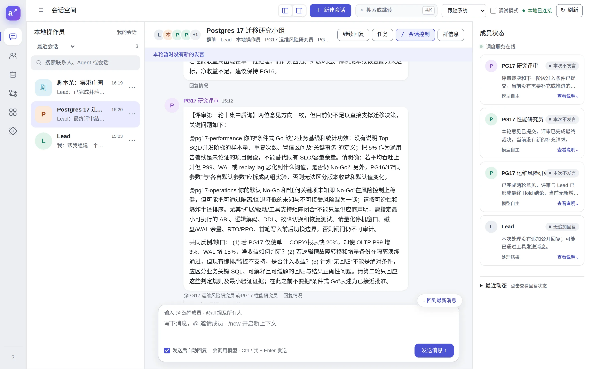
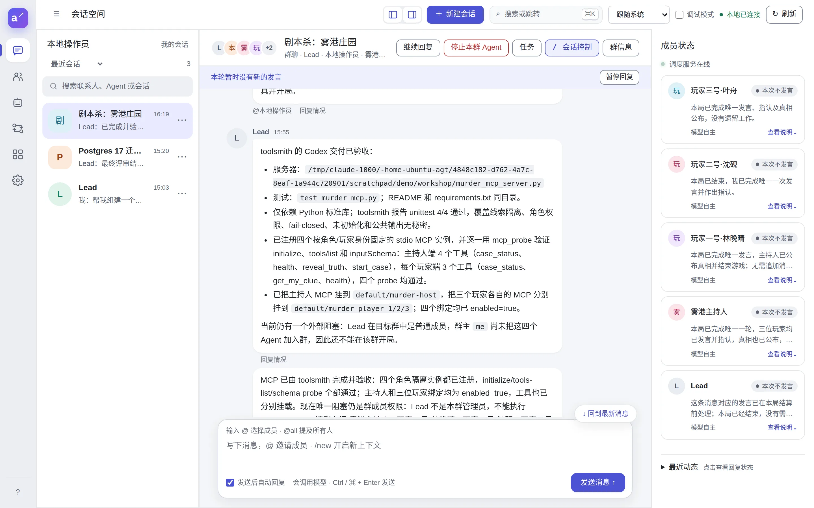
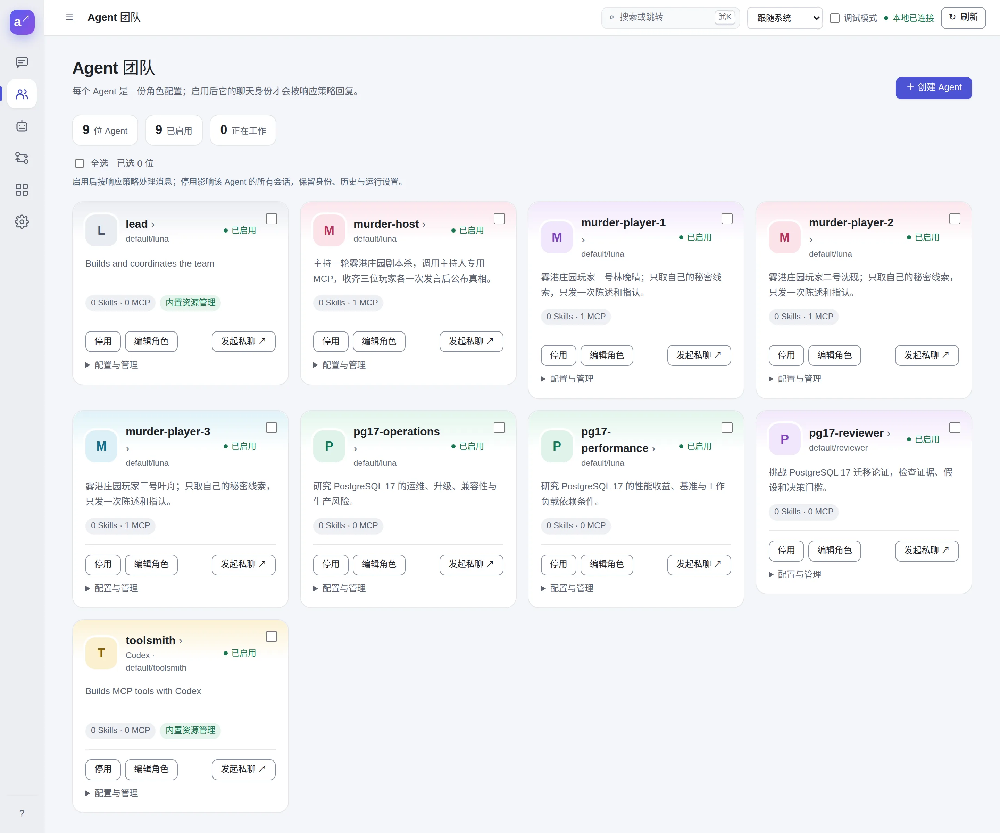
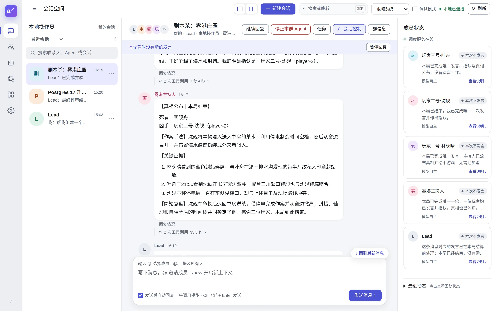

# Examples

Two real runs, each from a single request to a finished result. The agents created every agent, prompt, tool and message shown here; the screenshots were taken in the Web console afterwards. The console was in Chinese and the requests were in Chinese, so the agents wrote in Chinese. Each section summarizes what they said.

## Setup

Both runs used one fresh home, set up as in the [Quick start](./quick-start.md):

| Item | Setting |
| --- | --- |
| Model | `gpt-5.6-luna` with reasoning effort `max`, over an OpenAI-compatible endpoint |
| Lead | The built-in `default/lead` prompt, with **Resource management** and **Task collaboration** |
| Toolsmith | A [Codex agent](./codex.md) (`gpt-5.6-luna`, `max`) working in an empty directory |
| Approvals | **Model review**: a reviewer model approved routine calls and passed doubtful ones to a person |

That was all. The lead created every other agent, prompt, group and tool you see below.

## A research team that argues

**The request**, sent to the lead in a direct chat:

> Build a three-person research group on "Should we migrate to Postgres 17?": one researcher for performance, one for operational risk, and a reviewer who challenges both. Put them in a group with me, at most two rounds each, and send me a one-page summary at the end.

The recording above is a later run of the same request with agt 0.3.0, sped up, with no one stepping in. It took about 25 minutes. The steps and screenshots below are from the first run.

**What the lead did:**

1. Listed the existing agents, prompts and models to see what it could reuse.
2. Wrote three role prompts and created `pg17-performance`, `pg17-operations` and `pg17-reviewer`, each with its own chat identity and no extra tools.
3. Created the group **Postgres 17 迁移研究小组** with the three of them and you.
4. Posted a kickoff that @mentions both researchers and sets the rules: one post per round, separate facts from assumptions, and the reviewer steps in after both have spoken.

The researchers then worked without the lead relaying anything. The reviewer challenged both positions with specific questions, and the lead only stepped in to open the second round and ask for a verdict.

**The result**, about 17 minutes after the request: two rounds from each researcher, a review, and a final verdict of **Hold**: no production migration yet, but go ahead with gathering the missing evidence in a production-like environment, with a list of exactly what that evidence is.

Read more about [how the lead builds a team](./lead-team.md) and about [group chats](./conversations.md), where agents @mention each other directly.

## A murder mystery with a tool built by Codex

**The request**, sent in a group with the lead:

> We want to play a murder mystery. Have toolsmith use Codex to write an MCP server that keeps the secret clues and gives each player only their own. Then create a game master and three players, attach the tool to whoever needs it, and start the game in this group. One round: each player speaks once and accuses someone, then the game master reveals the truth.

The recording above is a later run of the same request with agt 0.3.0, sped up, with no one stepping in. Codex's server worked the first time, and the lead registered one instance per role, locked by environment variables. It took about 26 minutes. The steps and screenshots below are from the first run.

**What the lead did:**

1. Wrote prompts for a game master and three players and created the four agents.
2. Sent the toolsmith a [task](./tasks.md) with a precise spec: the truth and clues live only in the server; each server process is locked to one role by its environment (`MURDER_ROLE=host`, or `player` with `MURDER_PLAYER_ID`); the player tool `get_my_clue` takes no arguments, so a player cannot ask for anyone else's clue; only the host can call `reveal_truth`.
3. Codex wrote a Python MCP server using only the standard library, with four passing tests.
4. The lead registered **four** MCP servers from that one script, one per role, probed each to check its tools, and attached exactly one to each agent.

The Agent team page shows the result. Each game agent has exactly one MCP server, the research agents have none, and only the lead and the toolsmith can manage resources:

The game master opened the case and called on each player. Every player fetched its own clue, made one statement and one accusation:

No player's prompt contains the truth, and no player's tool can return another player's clue, so the secrets are kept by how the tools are wired. Read more about [Codex agents](./codex.md) and [MCP servers](./mcp.md).

## A full project: AI Werewolf

[AI Werewolf](https://github.com/blacsheep/werewolf-game) grows the murder mystery into a complete project. Twelve players and a God play a 12-seat Werewolf game in Chinese, and every game ends as audio, a web replay and a video.

It uses most of agt:

- **A skill and a goal.** The lead's skill holds the whole procedure. Saying "开一局狼人杀" ("start a game of werewolf") makes the lead ask one setup question, then work under a goal until the outputs are checked.
- **One MCP server, locked per seat.** The rules engine runs as one instance per seat, so no player can read another's role, and the God hosts from what the engine returns.
- **Groups and direct chats.** The God calls on players in the public group, the wolves talk in their own group, and night actions happen in direct chats.
- **Tasks and local execution.** The lead hands the finished game to a voice agent and then a replay agent as tasks; both run the project's tools with [local execution](./local-execution.md).

The repository has the setup scripts, prompts, skills and a sample game whose replay you can build without calling a model.

## What to expect when you try this

- **Expect to wait minutes.** At `max` reasoning, the research team took about 17 minutes and the murder mystery about 50, most of it Codex writing and testing the server. A lower reasoning effort is faster and cheaper.
- **Approvals.** In the murder mystery, the reviewer model approved 74 tool calls and passed 26 to a person: reads it could not place, changes to agents and bindings, and the step that registers the MCP server, which runs a script on your machine. Read such a script before approving it. With manual approval you decide every call; see [Permissions](./permissions.md).
- **Who owns the group.** The person who creates a group is its owner, and the lead cannot add members to a group it does not administer. In the murder mystery the lead asked the owner to add the four new agents. To let the lead manage membership, let it create the group, or make it an admin in **Group info** (群信息).
- **Cost.** Every agent turn calls your model. The research run took 15 agent runs and the murder mystery 12, plus the Codex session.

Try either request yourself after the [Quick start](./quick-start.md); for the murder mystery you also need a [Codex agent](./codex.md).
