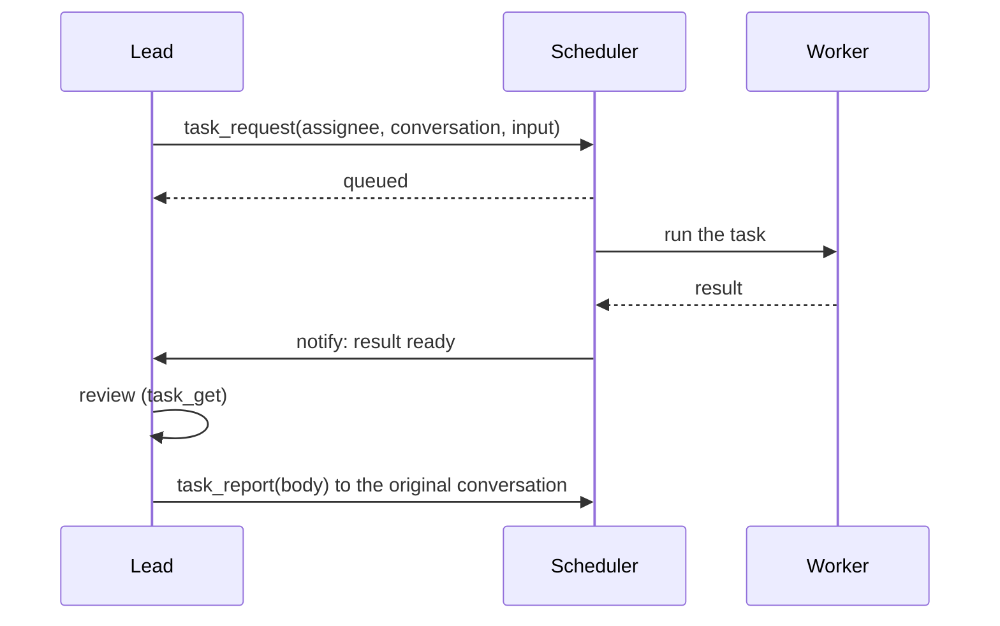

# Task collaboration

Messages are conversation: an agent may or may not answer, and nothing tracks whether work got
done. When one agent needs another to do a piece of work and return a result, it uses a
**task** instead.

| | Message | Task |
| --- | --- | --- |
| Delivery | Posted to the conversation | Queued for one assignee |
| Result | Whatever gets said | A recorded result, delivered back to the requester |
| States | — | queued, running, waiting, succeeded, failed, canceled, ... |
| Follow-up | — | The requester must file a report to the original conversation |
| Survives restarts | The message does | The task, its state and any checkpoint do |

## Enable it

Give `task_collaboration` to the agents that **request** work, usually the lead:

```bash
agt agent update lead --add-builtin-tool task_collaboration
```

Agents that only **receive** tasks need nothing extra; they only need to be bound and enabled.
The scheduler must be running (the Web console starts it).

## How a task flows



1. **Request.** The lead calls `task_request` with the assignee, a conversation both are in,
   the input, and a `request_key`. Repeating the same key returns the same task, so retries do
   not create duplicates.
2. **Run.** The scheduler runs the worker. Its final answer is the result, and agt posts it in
   the task's conversation; if the worker tries to post the result with `message_send`, the
   call is refused and it is told to answer instead. Failures and unclear outcomes are
   reported too.
3. **Notify.** The result is delivered to the lead, which starts a new run to handle it.
4. **Report.** The lead reviews the result and calls `task_report` to post a report in the
   original conversation. A normal message does not count as the report; if none is filed,
   the task shows that its report is still owed.

## Waiting for results

A lead that is itself working on a task can pause until its subtasks finish:

- `task_await` waits for one or up to 20 tasks. The agent saves a checkpoint and frees its
  slot; when the tasks finish, fail, or the deadline passes, it continues from the checkpoint.
  It must be the only tool call in that step.
- `task_yield` pauses until a given time.
- `task_input` asks the requester a question; the task waits until `task_reply` answers it or
  the deadline passes.

Waiting with a deadline never cancels the subtask and never fakes a result; late results are
still delivered.

## Managing the queue

Agents can also reprioritize, defer, cancel and retry queued tasks, and people can resolve
tasks whose outcome is unknown. The [Tasks module](../modules/tasks.md#managing-the-queue) lists
every tool and parameter.

Tasks that wait in the queue move up one priority level every five minutes, up to `high`.
Updates require the task's current `revision`, so two agents cannot overwrite each other's
changes.

## Parallel work

By default an agent works on one thing at a time. To let an agent run several independent
tasks at once:

1. Set `scheduler.parallel_work: true` (see [Tasks module](../modules/tasks.md#settings)).
2. Mark the tasks as parallel, and name the shared things they touch:

```json
{ "execution_policy": { "parallel": true, "exclusive_resources": ["repo:frontend"] } }
```

Tasks whose `exclusive_resources` overlap never run at the same time, even across agents.
These keys are agreements between agents, not file locks; agents must use the same key for the
same thing.

## In the Web console

Click **任务** (Tasks) in a conversation's title bar. The panel lists tasks in this
conversation, with filters for active, needs attention and finished, and a search box. Open a
task to see its state, result, delivery and report, and to answer, cancel, retry or resolve
it. **交互观察** (Interactions) shows delegations between agents as a graph.

## When something goes wrong

- **`outcome_unknown`**: the run was interrupted and agt cannot tell whether the work
  happened. It is never retried automatically. Check the actual result (files, messages,
  external systems), then use `task_resolve` to record what happened, and `task_retry` if it
  failed.
- **Stuck in `queued`**: the assignee may be disabled, set to `manual`, or the discussion may
  be paused or expired. `task_get` shows the reason in `blocked_reason`.
- **Report missing**: the lead received the result but did not call `task_report`. The task's
  report state stays `awaiting_report`, and after five minutes a reminder is raised.

From the CLI:

```bash
agt tool call --principal lead task_list --args '{"limit":20}'
agt tool call --principal lead task_get --args '{"task_id":"<id>"}'
```

Every tool and parameter is listed in the [Tasks module](../modules/tasks.md).
