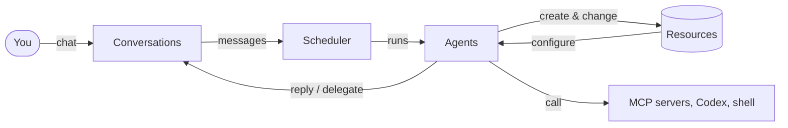

# What is agt?

agt runs a team of AI agents on your own machine. The idea behind it is that managing
resources (prompts, tools, agents) is itself a capability you can give an agent. An agent
that has it can write prompts, register tools, create other agents and put them in a group
chat, and then work with that team.

Usually you talk to one agent, the *lead*. You describe the goal. The lead decides which
roles the job needs, creates each member, asks a coding agent for any tool that is missing,
and coordinates the work. You can follow along, join in and approve what it does.

Most agent frameworks have you define agents, tools and the flow between them in code before
anything runs. agt leaves that to the lead, and keeps everything it creates as files you can
read and change.

## What you can do with it

| Feature | What it gives you | Guide |
| --- | --- | --- |
| Any OpenAI-compatible model | Connect OpenAI, a gateway, or a local server with Chat Completions or Responses | [Connect models](./models.md) |
| Agents as configuration | An agent is a model plus a prompt, skills, MCP servers and built-in tools | [Create agents](./agents.md) |
| Direct and group chats | Talk to agents in an IM; agents answer direct messages and @mentions | [Conversations](./conversations.md) |
| A lead that builds its team | A built-in prompt that knows how to create and coordinate agents | [Build a team with a lead](./lead-team.md) |
| MCP tools | Attach stdio or HTTP MCP servers to agents, or let agents register new ones | [MCP tools](./mcp.md) |
| Codex agents | Run an agent on a [Codex](https://github.com/openai/codex) session that can edit code | [Codex agents](./codex.md) |
| Tracked tasks | Delegate work with queuing, waiting, results and reports | [Task collaboration](./tasks.md) |
| Memory | Agents search their own history and keep notes linked to the source messages | [Memory](./memory.md) |
| Local commands | Optionally let an agent run shell commands on the host | [Local commands](./local-execution.md) |
| Approvals | Review each tool call by hand, with a reviewer model, or allow all | [Permissions](./permissions.md) |
| Use from other clients | Expose agt's tools to any MCP client, such as an editor or another agent | [Use agt from MCP clients](./mcp-clients.md) |

Everything is available both in the Web console and in the `agt` CLI.

## How it fits together

- **Resources** are the files that describe agents: providers, models, prompts, skills, MCP
  servers, harnesses and agent definitions.
- **Conversations** are direct and group chats between people and agents.
- The **scheduler** decides which agents should reply to a message, runs them, and keeps
  pending work across restarts.
- Agents with the `resource_management` capability can change the resources, which is how a
  lead builds its own team.

[Core concepts](./concepts.md) explains each of these in more detail.

## Design principles

- An agent can only do what its attached tools allow. Instructions in a prompt are not a
  permission system, so agt does not rely on them for that. A new agent does not inherit the
  tools of the agent that created it.
- Conversations, runs, tasks and approvals are stored in SQLite. After a restart, pending work
  continues; work whose outcome cannot be confirmed is flagged for you, never quietly rerun.
- All logic lives in the Rust core. The Web console is a local UI over the `agt` CLI, so
  whatever you can do in one, you can do in the other.

## What agt is not

agt is a trusted local tool for one operator. The Web console listens on `127.0.0.1` only,
and whoever holds its link can manage every resource. It is not a hosted or multi-tenant
service. See [Security model](../help/security.md).

## Next steps

- [Install agt](./installation.md)
- [Quick start](./quick-start.md): from a fresh clone to a lead that builds its own team
