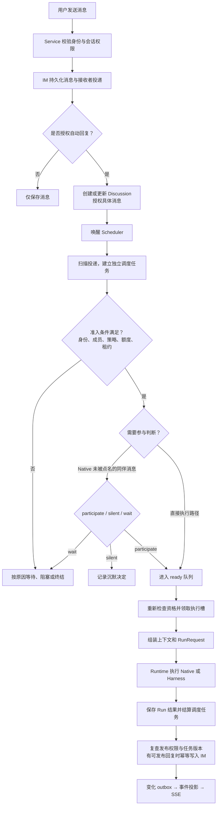

# 消息调度流程

最近代码核对：2026-10-09。此图描述普通聊天；明确工作任务另见[异步任务协作](task-flow.md)。

## 关键约束

- 写入消息不等于授权推理。Web 开启自动回复时，在发送成功后调用 `schedule start --message`。
- 普通消息独立入队，没有固定五秒合并窗口；模型显式请求的定时或安静等待仍可用。
- 每个 home 只有一个活跃协调器；内部并发可配置，默认 3。同一身份默认串行。
- 自主接话在同一会话内依次开始；明确请求可以在不同身份之间并发。
- Native 参与判断与正式回复是两次准入；判断结束先释放执行槽，历史变化可能使旧判断失效。
- Harness 不借用 Native 模型做参与判断；仍检查 manual、成员、授权和引擎适用的响应策略。
- 调度正常等待提交通知、执行完成或到期时间，并保留低频修复扫描。
- 过期的参与判断可以重新排队；已经进入回复执行且失去所有权的任务会被标记中断，不自动重放副作用。

## 代码入口

- [Web 发送与授权](../../../web/server.mjs)：`message_send` 后调用 `schedule start`。
- [协调循环](../../../crates/agt-runtime/src/scheduler.rs)：`Scheduler::run`、`tick`、`dispatch_ready`。
- [投递入队](../../../crates/agt-runtime/src/scheduler/ingress.rs)。
- [讨论授权与控制](../../../crates/agt-runtime/src/scheduler/controls.rs)。
- [准入](../../../crates/agt-runtime/src/scheduler/admission.rs)与[引擎差异](../../../crates/agt-runtime/src/scheduler/backend.rs)。
- [Run 构造](../../../crates/agt-runtime/src/scheduler/execution.rs)与[结果结算](../../../crates/agt-runtime/src/scheduler/completion.rs)。
- [调度持久化](../../../crates/agt-runtime/src/schedule_store.rs)：原子领取、租约和版本检查。

返回[架构图导航](index.md)。
