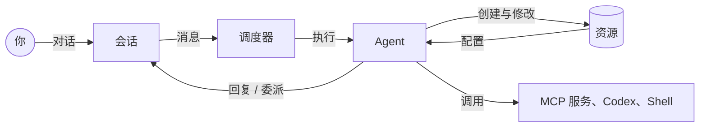

# agt 是什么？

agt 是一个在你自己机器上运行 AI Agent 团队的框架。它的核心想法是：**资源管理本身就是一种可以交给 Agent 的能力。**
拥有这项能力的 Agent 可以自己写 Prompt、注册工具、创建其他 Agent 并把它们拉进群聊，再用这支团队完成工作。

实际使用时，你只需要和一个 Agent 对话，也就是 *lead*。你描述目标，lead 设计团队、创建每个成员、
让编程 Agent 补齐缺少的工具，并在你的注视下协调整个工作。

## 能用它做什么

| 功能 | 带来什么 | 指南 |
| --- | --- | --- |
| 任意 OpenAI 兼容模型 | 接入 OpenAI、API 网关或本地服务，支持 Chat Completions 和 Responses | [接入模型](./models.md) |
| Agent 即配置 | Agent 由模型、Prompt、Skill、MCP 服务和内置工具组合而成 | [创建 Agent](./agents.md) |
| 私聊与群聊 | 在 IM 中和 Agent 对话；Agent 回复私聊和 @提及 | [对话与自动回复](./conversations.md) |
| 会自己组队的 lead | 内置 Prompt，知道如何创建和协调 Agent | [让 lead 组建团队](./lead-team.md) |
| MCP 工具 | 给 Agent 挂载 stdio 或 HTTP MCP 服务，或让 Agent 自己注册新服务 | [MCP 工具](./mcp.md) |
| Codex Agent | 让 Agent 运行在可以改代码的 [Codex](https://github.com/openai/codex) 会话上 | [Codex Agent](./codex.md) |
| 可追踪任务 | 带排队、等待、结果和汇报的工作委派 | [任务协作](./tasks.md) |
| 记忆 | Agent 搜索自己的历史，并保存关联原始消息的笔记 | [记忆](./memory.md) |
| 本机命令 | 可选地允许 Agent 在宿主机上执行 Shell 命令 | [本机命令](./local-execution.md) |
| 审批 | 人工、审核模型或全部放行，逐个审核工具调用 | [权限审批](./permissions.md) |
| 外部客户端接入 | 把 agt 的工具开放给任意 MCP 客户端，例如编辑器或其他 Agent | [在 MCP 客户端中使用 agt](./mcp-clients.md) |

以上功能在 Web 控制台和 `agt` CLI 中都能使用。

## 各部分如何配合

- **资源**是描述 Agent 的文件：Provider、Model、Prompt、Skill、MCP 服务、Harness 和 Agent 定义。
- **会话**是人和 Agent 之间的私聊与群聊。
- **调度器**决定哪些 Agent 应该回复一条消息、执行它们，并在重启后保留待完成的工作。
- 拥有 `resource_management` 能力的 Agent 可以修改资源，lead 正是这样组建自己的团队的。

[核心概念](./concepts.md)会更详细地解释这些内容。

## 设计原则

- **能力来自工具，而不是指令。** Agent 只能做挂载的工具允许它做的事。新建的 Agent 不会继承创建者的能力。
- **默认持久化。** 会话、执行、任务和审批都保存在 SQLite 中，重启后未完成的工作会继续，而不是丢失或被悄悄重做。
- **一个核心，两个入口。** 所有逻辑都在 Rust 核心中。Web 控制台是同一个 CLI 之上的轻量本地界面，两边能做的事情相同。

## agt 不是什么

agt 是供单个操作者使用的可信本地工具。Web 控制台只监听 `127.0.0.1`，持有链接的人可以管理所有资源。
它不是托管服务，也不支持多租户。见[安全模型](../help/security.md)。

## 下一步

- [安装 agt](./installation.md)
- [快速开始](./quick-start.md)：从全新安装到一个会自己组队的 lead
